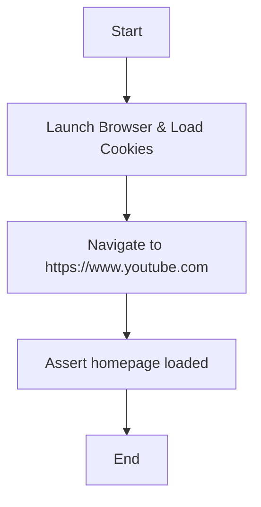

# UI Workflows Implementation Plan (2026-11-14 08:54)

## Overview
This plan outlines the end‑to‑end setup and development of a Playwright UI‑automation suite for the *Video Gen Google Flow* and *Open YouTube* scenarios. The project will be written in **TypeScript**, follow a **feature‑based architecture**, employ the **Page‑Object Model (POM)**, and use a **Configs** class for all environment values. Cookies are persisted to avoid repeated logins. Automation is executed via the Playwright test runner (`npx playwright test`).

---

## 1. Project Skeleton (Feature‑Based)
```
ui-workflows/
├─ src/
│  ├─ config/                     # Central configuration (Config.ts)
│  │  └─ Config.ts
│  ├─ features/                  # One folder per feature / scenario
│  │  ├─ videoGenGoogleFlow/      
│  │  │  ├─ pages/                # POM files
│  │  │  │  ├─ FlowHomePage.ts
│  │  │  │  ├─ LoginPage.ts
│  │  │  │  └─ ProjectPage.ts
│  │  │  └─ tests/                # Playwright test files
│  │  │     └─ videoGenGoogleFlow.spec.ts
│  │  └─ openYoutube/
│  │     ├─ pages/
│  │     │  └─ YoutubeHomePage.ts
│  │     └─ tests/
│  │        └─ openYoutube.spec.ts
│  ├─ utils/                     # Shared helpers (CookieManager, Logger)
│  │  └─ CookieManager.ts
│  └─ fixtures/                  # Optional test fixtures
├─ .env                           # Sensitive credentials (git‑ignored)
├─ .gitignore                     # Ensure .env & cookies.json are ignored
├─ playwright.config.ts           # Global Playwright configuration
├─ package.json
├─ README.md
└─ ARCHITECTURE.md                # High‑level diagram & description
```

### Why feature‑based?
* Isolates each automation scenario – easy to add new ones later.
* Keeps test files close to the pages they exercise.
* Aligns with the *pony‑tail* principle of “small, focused change per feature”.

---

## 2. Page‑Object Model (POM) Design
* **BasePage** – common helpers (`click`, `fill`, `waitForNavigation`).
* **FlowHomePage** – methods for opening Google Flow and clicking the *Create with Google Flow* button.
* **LoginPage** – methods to input email, password, and handle the OTP‑wait timer.
* **ProjectPage** – method to click *New Project* after login.
* **YoutubeHomePage** – method to navigate to YouTube homepage.

Each page returns `this` for fluent chaining and uses the shared `CookieManager` to load/save cookies.

---

## 3. Configs Class
`src/config/Config.ts`
```ts
import * as dotenv from "dotenv";
dotenv.config();

export default class Config {
  static readonly GOOGLE_FLOW_URL = "https://flow.google.com/";
  static readonly YOUTUBE_URL = "https://www.youtube.com/";
  static readonly EMAIL = process.env.GOOGLE_FLOW_EMAIL ?? "";
  static readonly PASSWORD = process.env.GOOGLE_FLOW_PASSWORD ?? "";
  static readonly COOKIE_PATH = "./cookies.json";
}
```
* All test files import `Config` for URLs, credentials, and cookie path.
* `.env` is **git‑ignored** (`.gitignore` entry).

---

## 4. Cookie Management
`src/utils/CookieManager.ts`
```ts
import { BrowserContext } from "@playwright/test";
import * as fs from "fs";
import Config from "../config/Config";

export class CookieManager {
  static async load(context: BrowserContext) {
    if (fs.existsSync(Config.COOKIE_PATH)) {
      const cookies = JSON.parse(fs.readFileSync(Config.COOKIE_PATH, "utf‑8"));
      await context.addCookies(cookies);
    }
  }

  static async save(context: BrowserContext) {
    const cookies = await context.cookies();
    fs.writeFileSync(Config.COOKIE_PATH, JSON.stringify(cookies, null, 2));
  }
}
```
* Tests call `await CookieManager.load(context)` at start and `await CookieManager.save(context)` at end.
* If the cookie file does **not** exist, the login flow runs; otherwise it is skipped.

---

## 5. Test Execution Flow
```bash
# Install dependencies (once)
npm i -D @playwright/test dotenv
# Initialise Playwright browsers (once)
npx playwright install
# Run all features
npx playwright test
# Run a single feature
npx playwright test -g "Video Gen Google Flow"
```
* The Playwright config (`playwright.config.ts`) sets `testDir: "src/features"` and enables `trace: on-first-retry` for debugging.
* `package.json` script shortcut:
```json
"scripts": {
  "test": "npx playwright test"
}
```

---

## 6. High‑Level Flow Diagrams (Mermaid)
### 6.1 Video Gen Google Flow
```mermaid
flowchart TD
    A[Start] --> B[Launch Browser & Load Cookies]
    B --> |cookies exist| C[Skip Login]
    B --> |no cookies| D[Open flow.google.com]
    D --> E[Click "Create with Google Flow"]
    E --> F[Login Page – Fill Email]
    F --> G[Click Next]
    G --> H[Fill Password]
    H --> I[Click Next]
    I --> J[Wait for phone approval (timer)]
    J --> K[Save Cookies]
    K --> L[Click "New Project"]
    L --> M[Assert new project page loaded]
    M --> N[End]
    C --> L
```
### 6.2 Open YouTube


---

## 7. Implementation Steps (Timeline)
| Milestone | Description | Owner | Estimate |
|-----------|-------------|-------|----------|
| **0️⃣ Project Bootstrap** | `npm init`, install Playwright, dotenv, create `.gitignore` | – | 1 h |
| **1️⃣ Config & Utils** | Add `Config.ts` and `CookieManager.ts` | – | 2 h |
| **2️⃣ Google Flow Feature** | Implement page objects, login flow, cookie handling, test spec | – | 4 h |
| **3️⃣ YouTube Feature** | Implement `YoutubeHomePage` and test spec | – | 2 h |
| **4️⃣ Documentation** | Populate `README.md`, `ARCHITECTURE.md` (include diagrams), usage guide | – | 2 h |
| **5️⃣ CI / Parallel Runs (future)** | Add GitHub Actions workflow to run tests in parallel using stored cookies | – | 3 h |

---

## 8. Documentation Updates
* **README.md** – Quick‑start, prerequisites, how to add new features.
* **ARCHITECTURE.md** – The folder diagram above plus rationale for feature‑based + POM.
* Each feature folder contains a short `README.md` describing its purpose and any special notes.

---

## 9. Future Extensibility (Pony‑tail friendly)
* Add a new feature folder under `src/features/` following the same pattern – minimal boilerplate.
* Use the `pony‑tail` skill to generate scaffolding for a new automation in a single command (e.g., `pony‑tail generate feature <name>` – if you later install that skill).
* Cookie file can be shared across parallel workers to enable concurrent runs.

---

## 10. Risks & Mitigations
| Risk | Impact | Mitigation |
|------|--------|------------|
| OTP wait may stall indefinitely | Test hangs | Set a maximum timer (e.g., 2 min) and fail gracefully; log a reminder to approve on device. |
| Credentials leak | Security | `.env` and `cookies.json` are in `.gitignore`; advise using CI secret storage for CI runs. |
| UI changes on Google Flow | Breakage | Keep selectors in page objects; version‑control commits allow quick updates. |

---

*All the above is saved in* `d:\content-creation\workflow-automation\docs\implemenation-artifacts\UI_WORKFLOWS_IMPLEMENTATION_2026_11_14_0854.md`.
