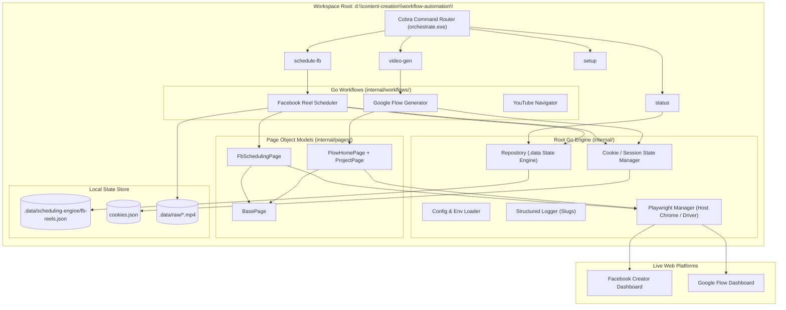

# Master Architecture & Implementation Plan: Root Go Agent Orchestration & UI Workflows Rewrite

**Document:** `3_AGENT_OCHESTRATION_AND_GO_REWRITE.md`  
**Date:** 2026-11-14  
**Project:** Marine Masterpieces Workflow Automation  
**Target Directory:** `d:\content-creation\workflow-automation\` (Workspace Root)  
**Author:** Antigravity (Ponytail Senior Dev Mode)  
**Status:** Ready for Autonomous Implementation

---

## Table of Contents
1. [Executive Summary & Architectural Decision](#1-executive-summary--architectural-decision)
2. [End-State System Architecture](#2-end-state-system-architecture)
3. [Playwright TypeScript vs. Playwright-Go API Translation Guide](#3-playwright-typescript-vs-playwright-go-api-translation-guide)
4. [Root Project Layout](#4-root-project-layout)
5. [Data Models & State Management](#5-data-models--state-management)
6. [Core Infrastructure (Config, Logger, Browser & Cookie Management)](#6-core-infrastructure-config-logger-browser--cookie-management)
7. [Page Object Model (POM) in Go](#7-page-object-model-pom-in-go)
8. [Workflow Implementations](#8-workflow-implementations)
   - [8.1 Facebook Reel Scheduling Workflow](#81-facebook-reel-scheduling-workflow)
   - [8.2 Google Flow Video Gen Workflow](#82-google-flow-video-gen-workflow)
   - [8.3 Open YouTube Workflow](#83-open-youtube-workflow)
9. [CLI Architecture & Commands (Cobra)](#9-cli-architecture--commands-cobra)
10. [Packaging, Self-Bootstrapping & Binary Distribution](#10-packaging-self-bootstrapping--binary-distribution)
11. [Step-by-Step Execution Plan for Autonomous Agents](#11-step-by-step-execution-plan-for-autonomous-agents)
12. [Verification & Acceptance Criteria](#12-verification--acceptance-criteria)

---

## 1. Executive Summary & Architectural Decision

### 1.1 Goal
Migrate the entire UI workflow automation suite (`ui-workflows` written in TypeScript/Node.js) directly into the **root workspace directory** `d:\content-creation\workflow-automation\` as a unified Go application.

Rather than isolating the Go code into a subfolder (`agent-ochestration-v1`), the root repository becomes a self-contained Go project:
1. `d:\content-creation\workflow-automation\` compiles directly into a **single standalone executable** (`orchestrate.exe` on Windows).
2. The root Go application natively drives browser automation via `github.com/playwright-community/playwright-go`.
3. Node.js, `npm`, and `ui-workflows/node_modules` are **completely eliminated** from the runtime dependency chain.
4. Relative pathing is greatly simplified: `.data/scheduling-engine/fb-reels.json` and `cookies.json` live directly relative to the workspace root without complex `../..` traversal.
5. The CLI handles Facebook Reel scheduling, Google Flow video generation, YouTube verification, status reporting, and automatic browser/driver bootstrapping.

### 1.2 Technology Stack
* **Language:** Go `1.24+` (Installed: `go version go1.24.4 windows/amd64`)
* **Browser Automation Engine:** `github.com/playwright-community/playwright-go`
* **CLI Framework:** `github.com/spf13/cobra`
* **Environment Configuration:** `github.com/joho/godotenv`
* **Target Browser:** Host Google Chrome (`channel: "chrome"`) with fallback to bundled Chromium.

---

## 2. End-State System Architecture



---

## 3. Playwright TypeScript vs. Playwright-Go API Translation Guide

When translating Playwright TypeScript to Go, syntax and concurrency models change. Use this exact translation table:

| Playwright TypeScript | Playwright-Go Equivalent | Notes |
| :--- | :--- | :--- |
| `chromium.launch({ channel: 'chrome', headless: false })` | `pw.Chromium.Launch(playwright.BrowserTypeLaunchOptions{ Channel: playwright.String("chrome"), Headless: playwright.Bool(false) })` | Pointers required for primitive options |
| `browser.newContext({ storageState: 'cookies.json' })` | `browser.NewContext(playwright.BrowserNewContextOptions{ StorageStatePath: playwright.String("cookies.json") })` | Native file loading |
| `context.storageState({ path: 'cookies.json' })` | `context.StorageState(playwright.BrowserContextStorageStateOptions{ Path: playwright.String("cookies.json") })` | Automatically captures cookies & local storage |
| `page.goto("https://...")` | `page.Goto("https://...", playwright.PageGotoOptions{ WaitUntil: playwright.WaitUntilStateNetworkidle })` | Returns `(playwright.Response, error)` |
| `page.getByRole('button', { name: 'Create', exact: true })` | `page.GetByRole("button", playwright.PageGetByRoleOptions{ Name: "Create", Exact: playwright.Bool(true) })` | Returns `playwright.Locator` |
| `page.locator('xpath=//*[@id="..."]')` | `page.Locator("xpath=//*[@id=\"...\"]")` | Supports xpath, css, text |
| `locator.click()` | `locator.Click()` | Always check error |
| `locator.fill("text")` | `locator.Fill("text")` | Clears and types |
| `locator.waitFor({ state: 'visible' })` | `locator.WaitFor(playwright.LocatorWaitForOptions{ State: playwright.WaitForSelectorStateVisible })` | Configurable timeout |
| `page.waitForURL("https://...")` | `page.WaitForURL("https://...", playwright.PageWaitForURLOptions{ Timeout: playwright.Float(180000) })` | Can accept regex pattern strings |
| `page.waitForTimeout(5000)` | `page.WaitForTimeout(5000)` or `time.Sleep(5 * time.Second)` | Use `page.WaitForTimeout` to align with browser event loop |
| `const [fileChooser] = await Promise.all([ page.waitForEvent('filechooser'), locator.click() ])` | `fileChooser, err := page.ExpectFileChooser(func() error { return locator.Click() })` | **Crucial:** Go uses callback closure for event interception |
| `fileChooser.setFiles("path/to/video.mp4")` | `fileChooser.SetFiles("path/to/video.mp4")` | Accepts string or slice of strings |

---

## 4. Root Project Layout

Everything is placed directly in the workspace root `d:\content-creation\workflow-automation\`:

```
d:\content-creation\workflow-automation/
├── .data/
│   ├── raw/
│   │   └── 2026_11_22.mp4       # Video assets
│   └── scheduling-engine/
│       └── fb-reels.json        # Reels metadata & status tracking
├── cmd/
│   ├── root.go                  # Root command, global flags (--headed, --debug)
│   ├── schedule_fb.go           # 'schedule-fb' command: Runs FB reel scheduling
│   ├── video_gen.go             # 'video-gen' command: Runs Google Flow generation
│   ├── youtube.go               # 'youtube' command: Runs YouTube verification
│   ├── status.go                # 'status' command: Inspects fb-reels.json queue
│   └── setup.go                 # 'setup' command: Bootstraps Playwright driver/browsers
├── internal/
│   ├── config/
│   │   └── config.go            # Reads .env, provides root paths, URLs, timeouts
│   ├── data/
│   │   ├── models.go            # FbReelsData, Post, SchedulingInfo structs
│   │   └── repository.go        # Read, mutate & atomic write of fb-reels.json
│   ├── browser/
│   │   ├── session.go           # Playwright initialization, context creation & cleanup
│   │   └── cookies.go           # Cookie / StorageState persistence helpers
│   ├── pages/
│   │   ├── base_page.go         # Common locator & assertion helpers
│   │   ├── fb_scheduling_page.go# FB Creator Dashboard & Reel creation POM
│   │   ├── flow_home_page.go    # Google Flow home POM
│   │   └── project_page.go      # Google Flow Project POM
│   ├── workflows/
│   │   ├── fb_reels.go          # Core Facebook Reel scheduling workflow
│   │   ├── google_flow.go       # Core Google Flow video generation workflow
│   │   └── youtube.go           # Core YouTube workflow
│   └── logger/
│       └── logger.go            # Structured logger with [LEVEL] [SLUG] formatting
├── .env                         # Environment variables (credentials)
├── .gitignore                   # Ignores orchestrate.exe, cookies.json, etc.
├── cookies.json                 # Session auth cookies (auto-saved)
├── go.mod                       # Root Go module definition (workflow-automation)
├── go.sum                       # Go dependencies lock
├── build.ps1                    # Root build script for Windows (compiles orchestrate.exe)
├── main.go                      # Root CLI entry point
└── ui-workflows/                # (Deprecated: to be archived/removed once Go is live)
```

---

## 5. Data Models & State Management

### 5.1 Structs (`internal/data/models.go`)
Reflects the exact JSON contract in `.data/scheduling-engine/fb-reels.json`:

```go
package data

type SchedulingInfo struct {
	IsSuccess bool `json:"isSuccess"`
	Tried     bool `json:"tried"`
}

type Post struct {
	Caption        string         `json:"caption"`
	VideoPath      string         `json:"videoPath"`
	SchedulingInfo SchedulingInfo `json:"schdulingInfo"`
}

type FbReelsData struct {
	FbPageSlug string `json:"fbPageSlug"`
	PageName   string `json:"pageName"`
	Posts      []Post `json:"posts"`
}
```

### 5.2 Atomic Repository (`internal/data/repository.go`)
Ensures thread-safe reads and atomic writes (writing to temp file then renaming) to prevent corruption if the process is terminated mid-write:

```go
package data

import (
	"encoding/json"
	"fmt"
	"os"
	"sync"
)

type Repository struct {
	filePath string
	mu       sync.Mutex
}

func NewRepository(filePath string) *Repository {
	return &Repository{filePath: filePath}
}

func (r *Repository) Load() (*FbReelsData, error) {
	r.mu.Lock()
	defer r.mu.Unlock()

	bytes, err := os.ReadFile(r.filePath)
	if err != nil {
		return nil, fmt.Errorf("failed to read %s: %w", r.filePath, err)
	}

	var data FbReelsData
	if err := json.Unmarshal(bytes, &data); err != nil {
		return nil, fmt.Errorf("failed to parse JSON from %s: %w", r.filePath, err)
	}

	return &data, nil
}

func (r *Repository) Save(data *FbReelsData) error {
	r.mu.Lock()
	defer r.mu.Unlock()

	bytes, err := json.MarshalIndent(data, "", "    ")
	if err != nil {
		return fmt.Errorf("failed to marshal data: %w", err)
	}

	tempFile := r.filePath + ".tmp"
	if err := os.WriteFile(tempFile, bytes, 0644); err != nil {
		return fmt.Errorf("failed to write temp file: %w", err)
	}

	if err := os.Rename(tempFile, r.filePath); err != nil {
		return fmt.Errorf("failed to atomically commit file: %w", err)
	}

	return nil
}
```

---

## 6. Core Infrastructure

### 6.1 Configuration (`internal/config/config.go`)
Since everything is at root, path resolution is clean and direct:

```go
package config

import (
	"os"
	"path/filepath"

	"github.com/joho/godotenv"
)

type Config struct {
	WorkspaceRoot          string
	FbReelsDataPath        string
	CookiesPath            string
	GoogleFlowURL          string
	YouTubeURL             string
	FbBaseURL              string
	FbScheduledContentURL  string
	GoogleFlowEmail        string
	GoogleFlowPassword     string
}

func Load() (*Config, error) {
	_ = godotenv.Load(".env")

	execDir, _ := os.Getwd()
	// Detect workspace root
	workspaceRoot := execDir
	if _, err := os.Stat(filepath.Join(execDir, ".data")); os.IsNotExist(err) {
		// If running from a subdirectory
		workspaceRoot = filepath.Clean(filepath.Join(execDir, ".."))
	}

	fbDataPath := filepath.Join(workspaceRoot, ".data", "scheduling-engine", "fb-reels.json")
	cookiePath := filepath.Join(workspaceRoot, "cookies.json")

	return &Config{
		WorkspaceRoot:         workspaceRoot,
		FbReelsDataPath:       fbDataPath,
		CookiesPath:           cookiePath,
		GoogleFlowURL:         "https://flow.google.com/",
		YouTubeURL:            "https://www.youtube.com/",
		FbBaseURL:             "https://www.facebook.com/",
		FbScheduledContentURL: "https://www.facebook.com/professional_dashboard/content/content_library/?filter=SCHEDULED",
		GoogleFlowEmail:       os.Getenv("GOOGLE_FLOW_EMAIL"),
		GoogleFlowPassword:    os.Getenv("GOOGLE_FLOW_PASSWORD"),
	}, nil
}
```

### 6.2 Structured Slug Logger (`internal/logger/logger.go`)
Preserves the exact slug tracing pattern used throughout `ui-workflows`:

```go
package logger

import (
	"fmt"
	"time"
)

func Info(slug, msg string) {
	log("INFO", slug, msg)
}

func Debug(slug, msg string) {
	log("DEBUG", slug, msg)
}

func Warn(slug, msg string) {
	log("WARN", slug, msg)
}

func Error(slug, msg string) {
	log("ERROR", slug, msg)
}

func log(level, slug, msg string) {
	timestamp := time.Now().UTC().Format(time.RFC3339Nano)
	fmt.Printf("[%s] [%s] [%s] %s\n", timestamp, level, slug, msg)
}
```

### 6.3 Browser & Session Lifecycle (`internal/browser/session.go`)
Manages Playwright startup, Chromium/Chrome launching with automation suppression flags, and automatic session persistence:

```go
package browser

import (
	"fmt"
	"os"

	"workflow-automation/internal/logger"
	"github.com/playwright-community/playwright-go"
)

type Session struct {
	PW         *playwright.Playwright
	Browser    playwright.Browser
	Context    playwright.BrowserContext
	CookiePath string
}

func NewSession(cookiePath string, headed bool) (*Session, error) {
	logger.Debug("Browser:NewSession", "Starting Playwright driver")
	pw, err := playwright.Run()
	if err != nil {
		return nil, fmt.Errorf("could not launch Playwright: %w", err)
	}

	launchOptions := playwright.BrowserTypeLaunchOptions{
		Headless: playwright.Bool(!headed),
		Channel:  playwright.String("chrome"), // Uses system Google Chrome
		Args: []string{
			"--disable-blink-features=AutomationControlled",
		},
		IgnoreDefaultArgs: []string{
			"--enable-automation",
		},
	}

	browser, err := pw.Chromium.Launch(launchOptions)
	if err != nil {
		// Fallback to default bundled Chromium if Chrome channel is unavailable
		logger.Warn("Browser:NewSession", "Host Chrome channel failed; falling back to bundled Chromium")
		launchOptions.Channel = nil
		browser, err = pw.Chromium.Launch(launchOptions)
		if err != nil {
			_ = pw.Stop()
			return nil, fmt.Errorf("could not launch browser: %w", err)
		}
	}

	contextOptions := playwright.BrowserNewContextOptions{
		Viewport: &playwright.Size{Width: 1280, Height: 720},
	}

	// Load cookies if file exists
	if _, err := os.Stat(cookiePath); err == nil {
		logger.Info("Browser:NewSession", fmt.Sprintf("Loading storage state from %s", cookiePath))
		contextOptions.StorageStatePath = playwright.String(cookiePath)
	} else {
		logger.Info("Browser:NewSession", "No cookies file found; starting clean session")
	}

	context, err := browser.NewContext(contextOptions)
	if err != nil {
		_ = browser.Close()
		_ = pw.Stop()
		return nil, fmt.Errorf("could not create browser context: %w", err)
	}

	return &Session{
		PW:         pw,
		Browser:    browser,
		Context:    context,
		CookiePath: cookiePath,
	}, nil
}

func (s *Session) SaveCookies() error {
	logger.Debug("Browser:SaveCookies", fmt.Sprintf("Saving storage state to %s", s.CookiePath))
	_, err := s.Context.StorageState(s.CookiePath)
	if err != nil {
		return fmt.Errorf("failed to save storage state: %w", err)
	}
	logger.Info("Browser:SaveCookies", "Storage state saved successfully")
	return nil
}

func (s *Session) Close() {
	if s.Context != nil {
		_ = s.SaveCookies()
		_ = s.Context.Close()
	}
	if s.Browser != nil {
		_ = s.Browser.Close()
	}
	if s.PW != nil {
		_ = s.PW.Stop()
	}
}
```

---

## 7. Page Object Model (POM) in Go

### 7.1 Base Page (`internal/pages/base_page.go`)
```go
package pages

import (
	"workflow-automation/internal/logger"
	"github.com/playwright-community/playwright-go"
)

type BasePage struct {
	Page playwright.Page
}

func NewBasePage(page playwright.Page) BasePage {
	return BasePage{Page: page}
}

func (b *BasePage) Click(selector string) error {
	logger.Debug("BasePage:Click", "Clicking "+selector)
	return b.Page.Click(selector)
}

func (b *BasePage) Fill(selector, value string) error {
	logger.Debug("BasePage:Fill", "Filling "+selector)
	return b.Page.Fill(selector, value)
}

func (b *BasePage) WaitForNavigation() error {
	return b.Page.WaitForLoadState(playwright.PageWaitForLoadStateOptions{
		State: playwright.LoadStateNetworkidle,
	})
}
```

### 7.2 Facebook Scheduling Page (`internal/pages/fb_scheduling_page.go`)
Translates `FbReelSchedulingPage.ts` with 100% selector parity:

```go
package pages

import (
	"fmt"
	"strings"

	"workflow-automation/internal/logger"
	"github.com/playwright-community/playwright-go"
)

type FbSchedulingPage struct {
	BasePage
	baseURL               string
	scheduledContentURL   string
}

func NewFbSchedulingPage(page playwright.Page, baseURL, scheduledURL string) *FbSchedulingPage {
	return &FbSchedulingPage{
		BasePage:            NewBasePage(page),
		baseURL:             baseURL,
		scheduledContentURL: scheduledURL,
	}
}

func (f *FbSchedulingPage) Open(pageSlug string) error {
	targetURL := fmt.Sprintf("%s%s/", strings.TrimRight(f.baseURL, "/")+"/", pageSlug)
	logger.Debug("FbSchedulingPage:Open", "Navigating to "+targetURL)
	_, err := f.Page.Goto(targetURL)
	return err
}

func (f *FbSchedulingPage) HandleLoginIfRequired(pageSlug, pageName string) error {
	logger.Debug("FbSchedulingPage:HandleLoginIfRequired", "Checking for login indicator")
	loginIndicator := f.Page.GetByRole("button", playwright.PageGetByRoleOptions{Name: "Log in to Facebook"}).First()

	visible, err := loginIndicator.IsVisible()
	if err == nil && visible {
		logger.Info("FbSchedulingPage:HandleLoginIfRequired", "Login dialog detected. Waiting up to 3 minutes for manual sign-in...")
		
		expectedURL := fmt.Sprintf("%s/%s", strings.TrimRight(f.baseURL, "/"), pageSlug)
		err = f.Page.WaitForURL(expectedURL, playwright.PageWaitForURLOptions{
			Timeout: playwright.Float(180000), // 3 minutes
		})
		if err != nil {
			return fmt.Errorf("timeout waiting for login completion: %w", err)
		}

		// Wait for password field to detach
		_ = f.Page.Locator("input[type=\"password\"]").WaitFor(playwright.LocatorWaitForOptions{
			State:   playwright.WaitForSelectorStateHidden,
			Timeout: playwright.Float(180000),
		})

		logger.Info("FbSchedulingPage:HandleLoginIfRequired", "Manual sign-in completed")

		// Switch profile if necessary
		accBtn := f.Page.GetByRole("button", playwright.PageGetByRoleOptions{Name: "Account, your profile"})
		if err := accBtn.Click(); err == nil {
			switchBtn := f.Page.GetByRole("button", playwright.PageGetByRoleOptions{Name: fmt.Sprintf("Switch to %s", pageName)})
			_ = switchBtn.Click()
			logger.Info("FbSchedulingPage:HandleLoginIfRequired", "Switched to "+pageName)
		}
	} else {
		logger.Info("FbSchedulingPage:HandleLoginIfRequired", "Session already authenticated")
	}

	return nil
}

func (f *FbSchedulingPage) WaitForExactPageURL(pageSlug string) error {
	expectedURL := fmt.Sprintf("%s/%s", strings.TrimRight(f.baseURL, "/"), pageSlug)
	logger.Debug("FbSchedulingPage:WaitForExactPageURL", "Awaiting "+expectedURL)
	return f.Page.WaitForURL(expectedURL, playwright.PageWaitForURLOptions{
		Timeout: playwright.Float(120000),
	})
}

func (f *FbSchedulingPage) NavigateToScheduledContent() error {
	logger.Debug("FbSchedulingPage:NavigateToScheduledContent", "Navigating to Content Library")
	
	// Option A: Navigate via sidebar clicks if present
	creatorLink := f.Page.GetByRole("main", playwright.PageGetByRoleOptions{Name: "Page profile content"}).GetByRole("link", playwright.PageGetByRoleOptions{Name: "Creator Dashboard"})
	if err := creatorLink.Click(); err == nil {
		_ = f.Page.GetByRole("link", playwright.PageGetByRoleOptions{Name: "Content", Exact: playwright.Bool(true)}).Click()
		_ = f.Page.GetByRole("tab", playwright.PageGetByRoleOptions{Name: "Scheduled"}).Click()
		return nil
	}

	// Option B: Direct URL goto fallback
	_, err := f.Page.Goto(f.scheduledContentURL)
	return err
}

func (f *FbSchedulingPage) ClickCreateButton() error {
	logger.Debug("FbSchedulingPage:ClickCreateButton", "Clicking Create button")
	createBtn := f.Page.GetByRole("button", playwright.PageGetByRoleOptions{Name: "Create", Exact: playwright.Bool(true)})
	if err := createBtn.WaitFor(playwright.LocatorWaitForOptions{State: playwright.WaitForSelectorStateVisible}); err == nil {
		return createBtn.Click()
	}
	// Fallback to DOM XPath
	return f.Page.Click("xpath=//*[@id=\"prodash-create-button\"]/div")
}

func (f *FbSchedulingPage) UploadReelVideo(videoAbsPath string) error {
	logger.Debug("FbSchedulingPage:UploadReelVideo", "Uploading video: "+videoAbsPath)

	reelMenuItem := f.Page.GetByRole("menuitem", playwright.PageGetByRoleOptions{Name: "Reel", Exact: playwright.Bool(true)})

	// Intercept file chooser event cleanly without race condition
	fileChooser, err := f.Page.ExpectFileChooser(func() error {
		if err := reelMenuItem.Click(); err != nil {
			return f.Page.Click("xpath=//*[@id=\"prodash_create_menu_items\"]/div/div/div/div/div[1]/div/div[2]")
		}
		return nil
	})
	if err != nil {
		return fmt.Errorf("failed to trigger file chooser: %w", err)
	}

	if err := fileChooser.SetFiles(videoAbsPath); err != nil {
		return fmt.Errorf("failed to supply file to chooser: %w", err)
	}

	logger.Info("FbSchedulingPage:UploadReelVideo", "Video attached successfully")
	return nil
}

func (f *FbSchedulingPage) FillDetailsAndSchedule(caption string) error {
	logger.Debug("FbSchedulingPage:FillDetailsAndSchedule", "Filling caption and scheduling")
	
	// Wait 5s for Facebook video preview ingestion
	f.Page.WaitForTimeout(5000)

	// Focus editor and fill caption
	_ = f.Page.GetByRole("paragraph").Click()
	descBox := f.Page.GetByRole("textbox", playwright.PageGetByRoleOptions{Name: "Describe your reel..."})
	if err := descBox.Fill(caption); err != nil {
		return fmt.Errorf("could not fill caption: %w", err)
	}

	// Click Next
	if err := f.Page.GetByRole("button", playwright.PageGetByRoleOptions{Name: "Next"}).Click(); err != nil {
		return fmt.Errorf("could not click Next: %w", err)
	}

	// Click Schedule radio/button
	if err := f.Page.GetByRole("button", playwright.PageGetByRoleOptions{Name: "Schedule"}).Click(); err != nil {
		return fmt.Errorf("could not click Schedule: %w", err)
	}

	// Await date picker modal/dialog stabilization
	dialog := f.Page.GetByRole("dialog", playwright.PageGetByRoleOptions{Name: "Scheduling options"}).
		Locator("div").Filter(playwright.LocatorFilterOptions{HasText: "^Scheduling options$"})
	_ = dialog.WaitFor(playwright.LocatorWaitForOptions{
		State:   playwright.WaitForSelectorStateHidden,
		Timeout: playwright.Float(600000), // Up to 10 min for manual adjustment if paused
	})

	// Click Schedule post
	schedulePostBtn := f.Page.GetByRole("button", playwright.PageGetByRoleOptions{Name: "Schedule post"})
	if err := schedulePostBtn.Click(); err != nil {
		return fmt.Errorf("could not click Schedule post: %w", err)
	}

	logger.Info("FbSchedulingPage:FillDetailsAndSchedule", "Reel scheduled successfully on Facebook")
	return nil
}
```

---

## 8. Workflow Implementations

### 8.1 Facebook Reel Scheduling Workflow (`internal/workflows/fb_reels.go`)

```go
package workflows

import (
	"fmt"
	"os"
	"path/filepath"
	"time"

	"workflow-automation/internal/browser"
	"workflow-automation/internal/config"
	"workflow-automation/internal/data"
	"workflow-automation/internal/logger"
	"workflow-automation/internal/pages"
)

type FbReelsWorkflow struct {
	cfg  *config.Config
	repo *data.Repository
}

func NewFbReelsWorkflow(cfg *config.Config, repo *data.Repository) *FbReelsWorkflow {
	return &FbReelsWorkflow{cfg: cfg, repo: repo}
}

func (w *FbReelsWorkflow) Run(headed bool) error {
	logger.Info("FbReelsWorkflow:Run", "Starting Facebook Reel Scheduling Workflow")

	// 1. Load pending posts
	state, err := w.repo.Load()
	if err != nil {
		return fmt.Errorf("failed to load scheduling state: %w", err)
	}

	// Count pending
	pendingCount := 0
	for _, p := range state.Posts {
		if !p.SchedulingInfo.IsSuccess {
			pendingCount++
		}
	}
	if pendingCount == 0 {
		logger.Info("FbReelsWorkflow:Run", "All posts are already marked as scheduled. Nothing to do.")
		return nil
	}
	logger.Info("FbReelsWorkflow:Run", fmt.Sprintf("Found %d pending reels to schedule", pendingCount))

	// 2. Launch Browser Session
	session, err := browser.NewSession(w.cfg.CookiesPath, headed)
	if err != nil {
		return fmt.Errorf("failed to init browser session: %w", err)
	}
	defer session.Close()

	page, err := session.Context.NewPage()
	if err != nil {
		return fmt.Errorf("failed to create browser page: %w", err)
	}

	fbPage := pages.NewFbSchedulingPage(page, w.cfg.FbBaseURL, w.cfg.FbScheduledContentURL)

	// Step 1: Open Page URL
	if err := fbPage.Open(state.FbPageSlug); err != nil {
		return fmt.Errorf("failed to open page slug: %w", err)
	}

	// Step 2: Handle Login & OTP pause if required
	time.Sleep(3 * time.Second)
	if err := fbPage.HandleLoginIfRequired(state.FbPageSlug, state.PageName); err != nil {
		return fmt.Errorf("login handling failed: %w", err)
	}

	// Step 3: Ensure on exact page and persist auth cookies
	if err := fbPage.WaitForExactPageURL(state.FbPageSlug); err != nil {
		return fmt.Errorf("failed verifying page URL: %w", err)
	}
	_ = session.SaveCookies()

	// Step 4: Navigate to Scheduled Content Library
	if err := fbPage.NavigateToScheduledContent(); err != nil {
		return fmt.Errorf("failed navigating to Content Library: %w", err)
	}

	page.WaitForTimeout(5000)

	// Step 5: Process each post
	for i := range state.Posts {
		post := &state.Posts[i]
		if post.SchedulingInfo.IsSuccess {
			logger.Info("FbReelsWorkflow:Run", fmt.Sprintf("Skipping already scheduled post: %s", post.VideoPath))
			continue
		}

		videoAbsPath := filepath.Clean(filepath.Join(w.cfg.WorkspaceRoot, post.VideoPath))
		if _, err := os.Stat(videoAbsPath); os.IsNotExist(err) {
			logger.Error("FbReelsWorkflow:Run", fmt.Sprintf("Video file not found at %s. Marking tried=true", videoAbsPath))
			post.SchedulingInfo.Tried = true
			_ = w.repo.Save(state)
			continue
		}

		logger.Info("FbReelsWorkflow:Run", fmt.Sprintf("Scheduling video: %s", videoAbsPath))

		// Click Create
		if err := fbPage.ClickCreateButton(); err != nil {
			return fmt.Errorf("failed clicking Create button: %w", err)
		}

		// Click Reel & Attach video
		if err := fbPage.UploadReelVideo(videoAbsPath); err != nil {
			return fmt.Errorf("failed uploading reel video: %w", err)
		}

		// Fill Caption and Submit
		if err := fbPage.FillDetailsAndSchedule(post.Caption); err != nil {
			return fmt.Errorf("failed completing reel scheduling: %w", err)
		}

		// Update State and Persist immediately
		post.SchedulingInfo.IsSuccess = true
		post.SchedulingInfo.Tried = true
		if err := w.repo.Save(state); err != nil {
			logger.Error("FbReelsWorkflow:Run", "Failed to persist updated state: "+err.Error())
		} else {
			logger.Info("FbReelsWorkflow:Run", fmt.Sprintf("Successfully persisted state for: %s", post.VideoPath))
		}

		page.WaitForTimeout(10000)
	}

	logger.Info("FbReelsWorkflow:Run", "All reels scheduled successfully")
	return nil
}
```

### 8.2 Google Flow Video Gen Workflow (`internal/workflows/google_flow.go`)
```go
package workflows

import (
	"fmt"
	"time"

	"workflow-automation/internal/browser"
	"workflow-automation/internal/config"
	"workflow-automation/internal/logger"
	"github.com/playwright-community/playwright-go"
)

type GoogleFlowWorkflow struct {
	cfg *config.Config
}

func NewGoogleFlowWorkflow(cfg *config.Config) *GoogleFlowWorkflow {
	return &GoogleFlowWorkflow{cfg: cfg}
}

func (g *GoogleFlowWorkflow) Run(headed bool) error {
	logger.Info("GoogleFlowWorkflow:Run", "Starting Google Flow Video Gen Workflow")

	session, err := browser.NewSession(g.cfg.CookiesPath, headed)
	if err != nil {
		return err
	}
	defer session.Close()

	page, err := session.Context.NewPage()
	if err != nil {
		return err
	}

	logger.Debug("GoogleFlowWorkflow:Run", "Opening "+g.cfg.GoogleFlowURL)
	if _, err := page.Goto(g.cfg.GoogleFlowURL); err != nil {
		return err
	}

	createBtn := page.GetByText("Create with Google Flow")
	if visible, _ := createBtn.IsVisible(); visible {
		_ = createBtn.Click()
	}

	time.Sleep(5 * time.Second)

	// Detect Google Login redirect
	if page.URL() != "" && (page.URL() == "https://accounts.google.com" || len(page.URL()) > 25 && page.URL()[:25] == "https://accounts.google.com") {
		logger.Info("GoogleFlowWorkflow:Run", "Redirected to Google sign-in. Waiting 2 minutes for manual sign-in...")
		if err := page.WaitForURL("https://flow.google.com/**", playwright.PageWaitForURLOptions{
			Timeout: playwright.Float(120000),
		}); err != nil {
			return fmt.Errorf("timeout waiting for Google login: %w", err)
		}
		logger.Info("GoogleFlowWorkflow:Run", "Login completed")
	}

	// Click New Project
	newProj := page.Locator("text=New Project")
	if err := newProj.WaitFor(playwright.LocatorWaitForOptions{State: playwright.WaitForSelectorStateVisible}); err == nil {
		_ = newProj.Click()
		page.WaitForTimeout(5000)
		logger.Info("GoogleFlowWorkflow:Run", "Project created successfully")
	}

	_ = session.SaveCookies()
	return nil
}
```

### 8.3 Open YouTube Workflow (`internal/workflows/youtube.go`)
```go
package workflows

import (
	"workflow-automation/internal/browser"
	"workflow-automation/internal/config"
	"workflow-automation/internal/logger"
)

type YouTubeWorkflow struct {
	cfg *config.Config
}

func NewYouTubeWorkflow(cfg *config.Config) *YouTubeWorkflow {
	return &YouTubeWorkflow{cfg: cfg}
}

func (y *YouTubeWorkflow) Run(headed bool) error {
	logger.Info("YouTubeWorkflow:Run", "Navigating to YouTube")
	session, err := browser.NewSession(y.cfg.CookiesPath, headed)
	if err != nil {
		return err
	}
	defer session.Close()

	page, err := session.Context.NewPage()
	if err != nil {
		return err
	}

	if _, err := page.Goto(y.cfg.YouTubeURL); err != nil {
		return err
	}

	page.WaitForTimeout(10000)
	logger.Info("YouTubeWorkflow:Run", "YouTube loaded successfully")
	return nil
}
```

---

## 9. CLI Architecture & Commands (Cobra)

### 9.1 Root Command (`cmd/root.go`)
```go
package cmd

import (
	"os"

	"github.com/spf13/cobra"
)

var (
	headedFlag bool
	debugFlag  bool
)

var rootCmd = &cobra.Command{
	Use:   "orchestrate",
	Short: "Marine Masterpieces Agent Orchestration & UI Automation CLI",
	Long:  "A unified Go CLI for orchestrating AI video creation, metadata enrichment, and multi-platform reel scheduling.",
}

func Execute() {
	if err := rootCmd.Execute(); err != nil {
		os.Exit(1)
	}
}

func init() {
	rootCmd.PersistentFlags().BoolVar(&headedFlag, "headed", true, "Run browser in headed mode (visible UI)")
	rootCmd.PersistentFlags().BoolVar(&debugFlag, "debug", false, "Enable verbose debug logs")
}
```

### 9.2 Command Implementations
* **`cmd/schedule_fb.go`**:
  ```go
  var scheduleFbCmd = &cobra.Command{
      Use:   "schedule-fb",
      Short: "Schedule pending reels to Facebook Creator Dashboard",
      RunE: func(cmd *cobra.Command, args []string) error {
          cfg, err := config.Load()
          if err != nil { return err }
          repo := data.NewRepository(cfg.FbReelsDataPath)
          wf := workflows.NewFbReelsWorkflow(cfg, repo)
          return wf.Run(headedFlag)
      },
  }
  ```
* **`cmd/status.go`**:
  Renders a formatted table of all posts from `.data/scheduling-engine/fb-reels.json` showing caption preview, video path, `tried`, and `isSuccess`.
* **`cmd/setup.go`**:
  Executes `playwright.Install()` to download drivers and browser binaries if running on a fresh host without host Chrome.

### 9.3 Main Entry Point (`main.go`)
```go
package main

import "workflow-automation/cmd"

func main() {
	cmd.Execute()
}
```

---

## 10. Packaging, Self-Bootstrapping & Binary Distribution

### 10.1 Self-Bootstrapping Driver in Go
`playwright-go` includes driver distribution. To make the binary 100% self-bootstrapping, `setup.go` or the driver launcher executes:
```go
err := playwright.Install(&playwright.RunOptions{
    Browsers: []string{"chromium"},
})
```
When running with `Channel: "chrome"`, the binary automatically locates the host's Chrome installation at:
* Windows: `C:\Program Files\Google\Chrome\Application\chrome.exe` (or `Program Files (x86)`)

### 10.2 PowerShell Build Script (`build.ps1`)
Placed directly in the workspace root:

```powershell
# build.ps1
$ErrorActionPreference = "Stop"

Write-Host "==> Tidying Go modules at root..." -ForegroundColor Cyan
go mod tidy

Write-Host "==> Compiling standalone Windows executable (orchestrate.exe)..." -ForegroundColor Cyan
$env:CGO_ENABLED = "0"
go build -ldflags="-s -w" -o orchestrate.exe main.go

Write-Host "==> Build complete: orchestrate.exe" -ForegroundColor Green
Get-Item orchestrate.exe | Select-Object Name, Length, LastWriteTime
```

---

## 11. Step-by-Step Execution Plan for Autonomous Agents

Any autonomous agent or engineer can execute this complete rewrite directly in the root workspace by executing these sequential steps:

### Phase 1: Root Go Module Initialization
1. Navigate to workspace root:
   ```powershell
   cd d:\content-creation\workflow-automation
   ```
2. Initialize root Go module:
   ```powershell
   go mod init workflow-automation
   ```
3. Add dependencies:
   ```powershell
   go get github.com/playwright-community/playwright-go@v0.4201.1
   go get github.com/spf13/cobra@v1.8.0
   go get github.com/joho/godotenv@v1.5.1
   ```

### Phase 2: Core Infrastructure Creation
1. Write `internal/data/models.go` (models matching `fb-reels.json`).
2. Write `internal/data/repository.go` (atomic file persistence).
3. Write `internal/logger/logger.go` (slug logger).
4. Write `internal/config/config.go` (direct root workspace paths).
5. Write `internal/browser/session.go` (Playwright launcher & cookie manager).

### Phase 3: Page Object Models
1. Write `internal/pages/base_page.go`.
2. Write `internal/pages/fb_scheduling_page.go`.

### Phase 4: Workflows & CLI Commands
1. Write `internal/workflows/fb_reels.go`.
2. Write `internal/workflows/google_flow.go`.
3. Write `internal/workflows/youtube.go`.
4. Write `cmd/root.go`, `cmd/schedule_fb.go`, `cmd/video_gen.go`, `cmd/youtube.go`, `cmd/status.go`, and `cmd/setup.go`.
5. Write `main.go`.
6. Write `build.ps1`.

### Phase 5: Verification & Cleanup
1. Run `go vet ./...`.
2. Execute `.\build.ps1` to produce `orchestrate.exe`.
3. Execute `.\orchestrate.exe status` to verify repository connectivity to `.data/scheduling-engine/fb-reels.json`.
4. Execute `.\orchestrate.exe schedule-fb --headed` to execute the live Facebook Reel automation.
5. (Optional) Archive or remove `agent-ochestration-v1` and `ui-workflows`.

---

## 12. Verification & Acceptance Criteria

| Checkpoint | Validation Test | Expected Result |
| :--- | :--- | :--- |
| **Compilation** | `go build -o orchestrate.exe main.go` | Zero compiler errors; produces root `orchestrate.exe` (~20MB) |
| **State Inspection** | `.\orchestrate.exe status` | Correctly parses and displays all 4 posts in `.data/scheduling-engine/fb-reels.json` |
| **Driver Bootstrapping** | `.\orchestrate.exe setup` | Successfully installs Playwright driver without Node.js |
| **Browser Launch** | `.\orchestrate.exe youtube --headed` | Launches host Google Chrome, navigates to YouTube, closes cleanly |
| **FB Automation** | `.\orchestrate.exe schedule-fb --headed` | Navigates to FB page, pauses for sign-in if needed, opens Creator Dashboard, attaches `.data/raw/2026_11_22.mp4` via native file chooser, sets caption, schedules reel, and updates `isSuccess: true` in `fb-reels.json` |
| **Direct Paths** | Run from any directory | Loads `.data/scheduling-engine/fb-reels.json` and `cookies.json` without broken `../..` relative paths |
| **Self-Contained** | Run without `node_modules` | Functions completely independent of `ui-workflows/node_modules` |
